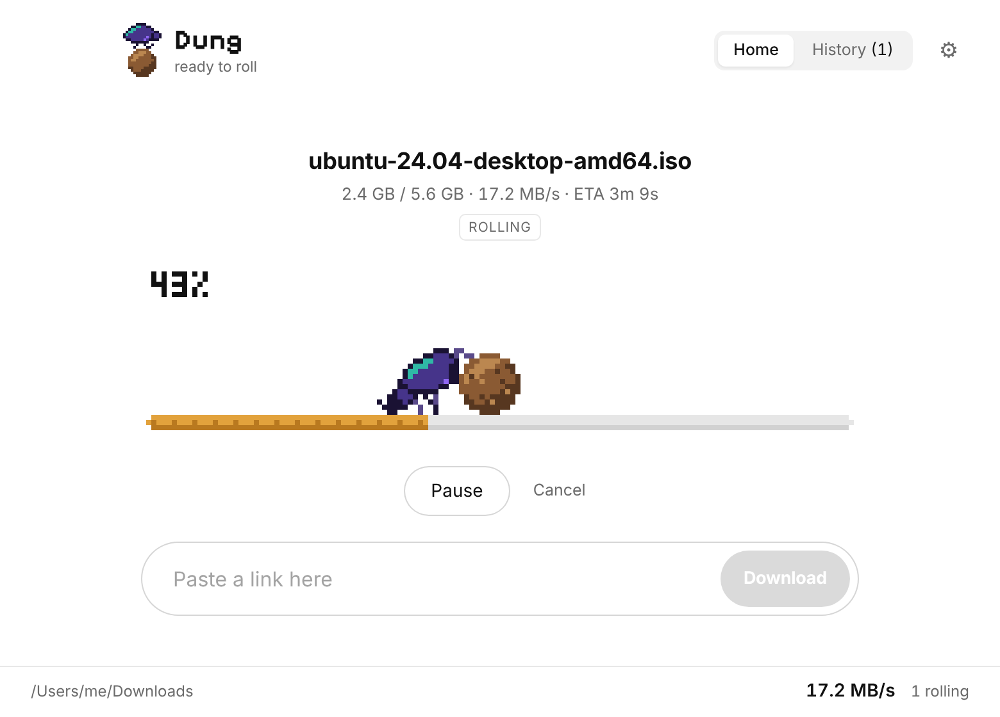
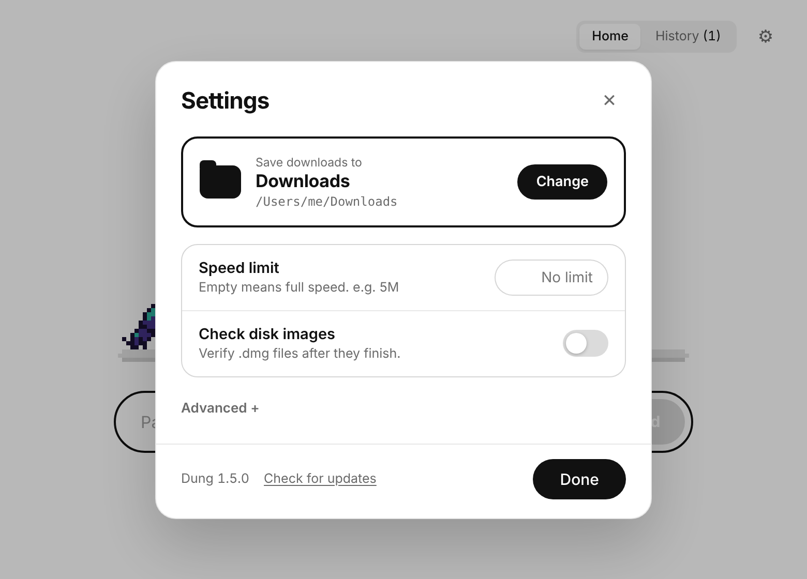
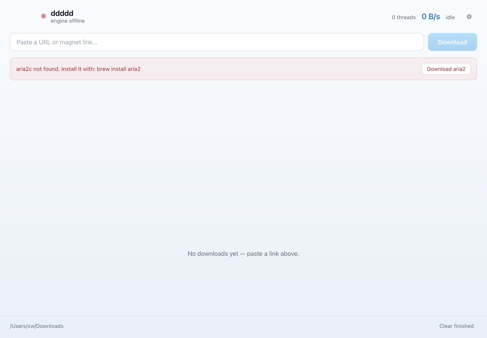

# ddddd

A native macOS download manager powered by [aria2](https://aria2.github.io/) — a real UI over the fastest download engine there is, with sane defaults and an integrity check that actually catches corruption.

<p>
  
  
  
  
  
  
  
  
  
</p>



## Why this exists

aria2 is excellent and its command line is hostile. Wrapping it badly is easy, and the failure mode is silent:

- `~/.aria2/aria2.conf` is read by default, so a stray `enable-rpc=true` or `split=10` changes what your app does.
- With 16 parallel connections, some CDNs return mismatched byte ranges. You get a file that is *exactly* the right size and still corrupt.
- `--file-allocation=none` truncates the file to full length immediately, so `ls -l` proves nothing.
- A stalled range can leave the daemon running forever while the download looks complete.

This app exists because an 845 MB DMG came down at 100% and macOS refused to open it. Every default here is a response to one of those failures.

## Features

| | |
|---|---|
| **Isolated engine** | Each launch spawns its own `aria2c` with `--no-conf=true`, a random localhost port, and a per-run RPC secret. Your global config cannot hijack it. |
| **Safe concurrency** | 4 connections / 4 splits by default. The slider warns loudly above 8 — the point where CDNs start corrupting large files. |
| **Disk image verification** | Every finished `.dmg` is checked with `hdiutil verify`; the row reports `checksum ok` or the failure reason. |
| **Visible internals** | Live split count and active thread count per download, plus a total in the header. |
| **Resumable queue** | `--save-session` / `--input-file` persist the queue; interrupted downloads resume on next launch. |
| **Live settings** | Changing connections, split, speed limit or folder goes through `changeGlobalOption`, so active downloads keep running. |
| **One-click recovery** | If `aria2c` is missing, the app installs it: Homebrew on macOS, the official upstream zip on Windows. |
| **Real progress** | Reads `completedLength` over RPC instead of trusting file size. |
| **X / Twitter videos** | Paste a status link and it resolves the direct `video.twimg.com` MP4 renditions. HLS-only posts are reported clearly instead of failing silently. |

| Settings | Engine offline |
|---|---|
|  |  |

## Install

Download the latest build from [**Releases**](https://github.com/xfanwu/ddddd/releases).

**macOS (Apple Silicon)** — open the DMG and drag **ddddd** to *Applications*.

```sh
curl -L -o ddddd.dmg https://github.com/xfanwu/ddddd/releases/latest/download/ddddd-1.1.0-arm64.dmg
open ddddd.dmg
```

**Windows (x64)** — run the `-setup.exe` installer, or use the portable `.exe` if you don't want
anything written to Program Files.

The app needs an `aria2c` binary. It finds Homebrew, MacPorts, Chocolatey, Scoop, `/usr/local/bin`,
a bundled `Contents/Resources/bin/aria2c`, or whatever path you set in Settings. If it finds nothing,
the window offers a **Download aria2** button:

- **macOS** runs `brew install aria2`.
- **Windows** downloads the official `aria2-*-win-64bit` zip from GitHub and unpacks `aria2c.exe`
  into `%APPDATA%\ddddd\bin`, so no package manager is required.

### First launch

**macOS** builds are unsigned, so Gatekeeper blocks them once:

```sh
xattr -dr com.apple.quarantine "/Applications/ddddd.app"
```

Or right-click the app → **Open** → **Open**.

**Windows** builds are unsigned too — SmartScreen shows "Windows protected your PC". Choose
**More info** → **Run anyway**.

## Build from source

```sh
git clone https://github.com/xfanwu/ddddd.git
cd ddddd
npm install
npm start          # run in development
npm run dist       # produce dist/ddddd-1.0.0-arm64.dmg
```

Requires Node 18+ and macOS. The icon is rendered from an emoji, so you can change it:

```sh
# edit EMOJI in scripts/make-icon.js, then
npx electron scripts/make-icon.js
cd build && iconutil -c icns icon.iconset -o icon.icns
```

## How it works

```
src/main/aria2.js       aria2c process + JSON-RPC client, polling, pause/resume, session
src/main/installer.js   gets aria2c onto the machine (Homebrew on mac, upstream zip on Windows)
src/main/resolvers/x.js turns x.com/twitter.com status URLs into direct MP4 links
src/main/main.js        Electron main: window, IPC, settings/history, hdiutil verification
src/main/preload.js     contextBridge API — the renderer gets no Node access
src/renderer/*          vanilla HTML/CSS/JS, no bundler, no framework
scripts/smoke-engine.js headless engine test
```

The renderer never talks to aria2 directly. Every call crosses IPC, so the RPC secret stays in the
main process and the UI cannot be tricked into issuing arbitrary RPC.

Progress comes from `aria2.tellStatus`, split and connection settings are remembered at queue time
because aria2 does not report them back through `tellStatus`.

## Testing

There is no test runner — the checks are real downloads through the real engine.

```sh
node scripts/smoke-engine.js                   # spawn, download, verify bytes, pause, resume, remove, shutdown
node scripts/smoke-x.js                        # resolve a real X post, download it, check the MP4 header

SMOKE_TEST=1 npx electron .                    # window boots, engine reports ready
SMOKE_TEST=1 SMOKE_DOWNLOAD=1 npx electron .   # IPC -> download -> rendered row
ARIA2C_FORCE_MISSING=1 SMOKE_TEST=1 SMOKE_INSTALL=1 npx electron .   # install flow
```

`ARIA2C_FORCE_MISSING=1` makes the *first* binary lookup fail so the install-then-redetect path can
be exercised on a machine that already has aria2.

## Notes on safety

- Never trust a large download's size as proof of integrity. Run `hdiutil verify` (automatic here for
  `.dmg` on macOS), or compare a published SHA-256.
- X video downloads rely on X's embedded-player payload exposing MP4 renditions. Long or
  protected posts that are HLS-only cannot be fetched by aria2 at all; the app says so rather
  than writing a broken file.
- Disk-image verification is macOS-only; the toggle is hidden on Windows because `hdiutil` does not
  exist there.
- Above 8 connections you are gambling on CDN consistency. The app defaults to 4 for that reason.
- Neither build is signed or notarized. macOS needs the quarantine flag cleared and Windows needs
  SmartScreen bypassed; both builds are reproducible from source.

## License

[MIT](LICENSE) © 2026 xfanwu

aria2 itself is GPL-2.0 and is **not** bundled — the app drives a separately installed binary.
