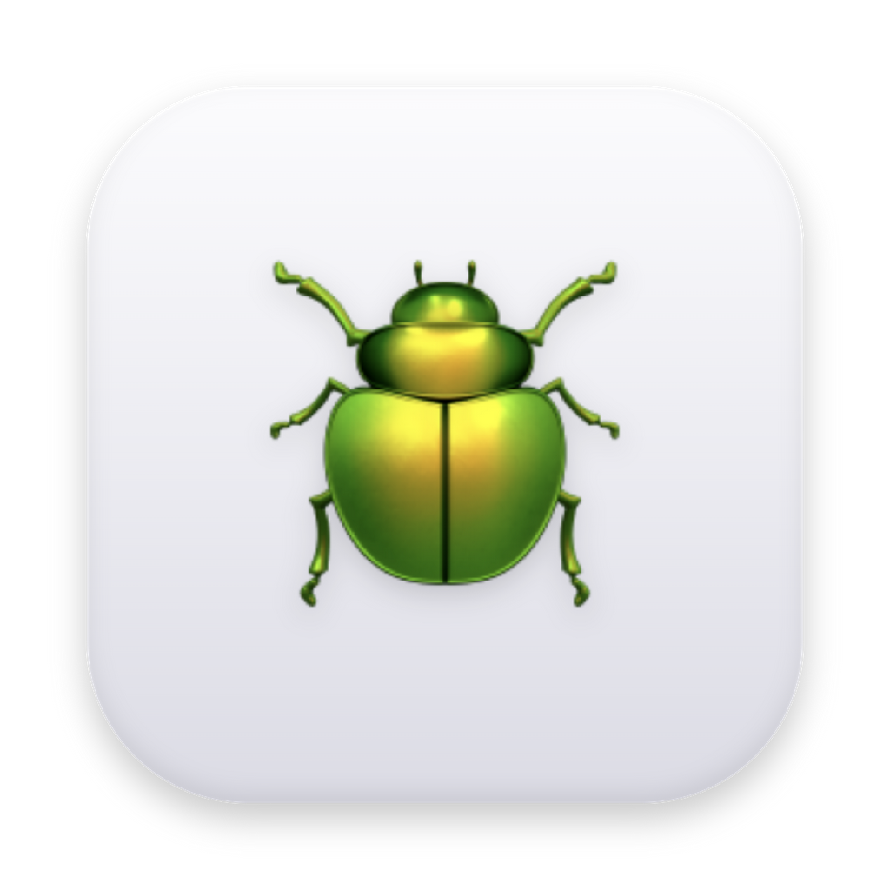
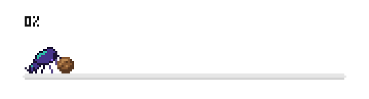

# Dung

**Paste a link. It downloads.**
A tiny download manager with a pixel dung beetle that rolls your files home.

  

  
  
  
  

---

### Paste. Watch. Open.

Press <kbd>⌘</kbd><kbd>V</kbd> anywhere in the window — or drop a link on it. A pixel beetle rolls your file home. Click **Open**. That's the whole manual.

### Why it's nice

- **Nothing to set up.** The downloader lives inside the app. Open it and paste.
- **Files that open.** Safe defaults stop the silent corruption big downloads suffer elsewhere — and it never overwrites your files.
- **Video pages too.** X, TikTok, Instagram and ~1,750 other sites.
- **Private.** No account, no cookies, no telemetry.
- **Speaks beetle.** Downloads are *rolling*, then *rolled home*.

### Get it

**[Download for Mac or Windows →](https://github.com/xfanwu/dung/releases/latest)**

First launch on Mac: right-click **Dung** → **Open** → **Open** (it's free and unsigned). On Windows: **More info** → **Run anyway**.

---

[Developing & how it works](docs/DEVELOPING.md) · [Design guide](docs/DESIGN.md) · [Changelog](CHANGELOG.md) · MIT © 2026 xfanwu · Bundles [aria2](https://aria2.github.io/) (GPL-2.0+, source attached to each release) and [Pixelify Sans](https://github.com/eifetx/Pixelify-Sans) (OFL)
